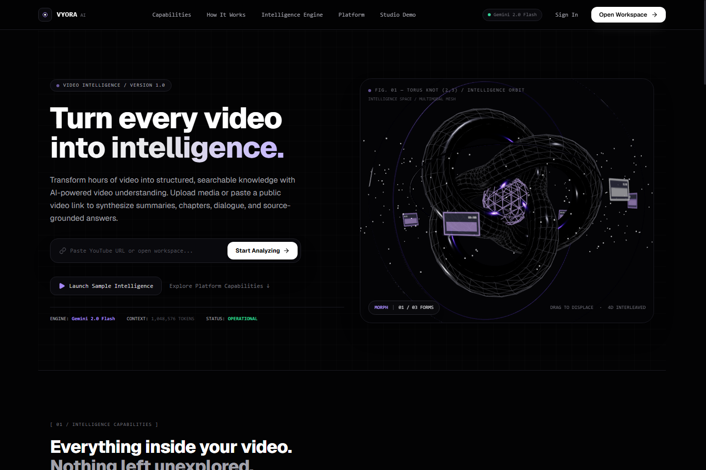
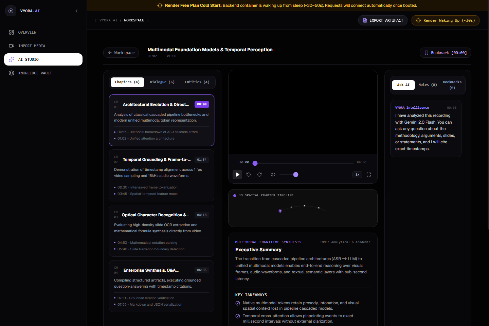
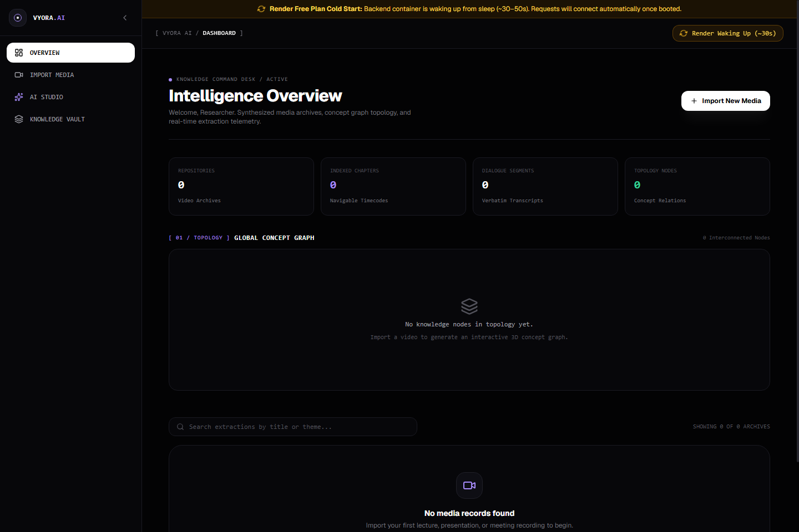
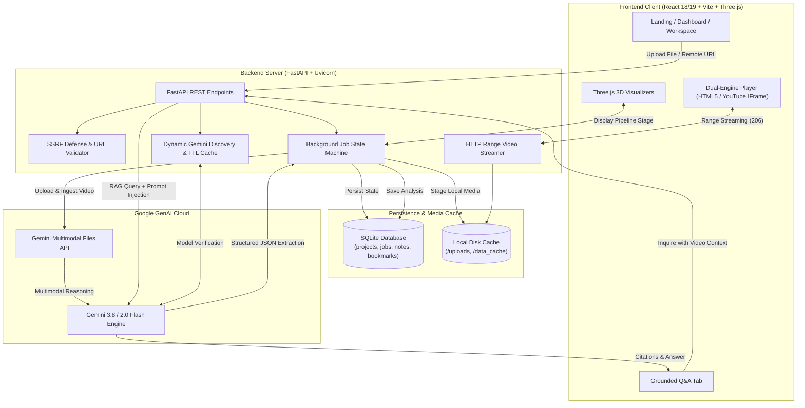

# VYORA AI — Video & Media Knowledge Extractor ⚡

<p align="center">
  
</p>

<p align="center">
  <strong>Every Video Holds a Universe of Knowledge.</strong><br>
  <em>An immersive, full-stack multimodal video intelligence platform powered by Google Gemini 3.8 Flash, FastAPI, Three.js, and React.</em>
</p>

<p align="center">
  <a href="https://fastapi.tiangolo.com"></a>
  <a href="https://react.dev"></a>
  <a href="https://threejs.org"></a>
  <a href="https://vitejs.dev"></a>
  <a href="https://tailwindcss.com"></a>
  <a href="https://aistudio.google.com"></a>
  <a href="https://docs.pytest.org"></a>
  <a href="LICENSE"></a>
</p>

---

## 📑 Table of Contents

- [Overview](#-overview)
- [Visual Interface & 3D Tour](#-visual-interface--3d-tour)
- [Core Capabilities](#-core-capabilities)
- [Interactive 3D Architecture](#-interactive-3d-architecture)
- [System Architecture & Data Flow](#-system-architecture--data-flow)
- [Repository Layout](#-repository-layout)
- [Local Development Quickstart](#-local-development-quickstart)
- [Environment Variables](#-environment-variables)
- [REST API Reference](#-rest-api-reference)
- [Automated Verification & Test Suite](#-automated-verification--test-suite)
- [Security & SSRF Guardrails](#-security--ssrf-guardrails)
- [License & Author](#-license--author)

---

## 🌟 Overview

**VYORA AI** transforms long-form video and audio content into structured, interactive knowledge bases. Rather than treating video simply as speech-to-text audio, VYORA AI leverages **Google's official GenAI SDK (Gemini 3.8 Flash / 2.0 Flash)** to perform true **multimodal inspection**: analyzing visual scenes, extracted audio tracks, OCR on-screen text, speaker sentiment, and structured conceptual entities simultaneously.

All extracted intelligence is mapped into a dark, cinematic workstation featuring a **dual-engine media player** (HTML5 Range Streaming + YouTube IFrame API), **3D spatial timeline orbital nodes**, **source-grounded Q&A chat** with clickable `[MM:SS]` timestamp badges, and real-time state machine persistence.

---

## 📸 Visual Interface & 3D Tour

| Cinematic Landing & 3D Core | Multimodal AI Workspace | Knowledge Hub & Project Library |
| :---: | :---: | :---: |
|  |  |  |
| *Three.js icosahedron core, orbital gimbal rings, and interactive scroll phases.* | *Dual-engine player, 3D curved timeline, chapter summaries & grounded Q&A.* | *Project library, telemetry analytics, search, bookmarks, and export.* |

---

## ⚡ Core Capabilities

### 1. Multimodal Video & Speech Intelligence
- Ingests MP4, WebM, MOV, AVI, MP3, WAV, and remote video streams.
- Deep visual analysis: detects slide changes, presentations, on-screen code snippets, diagrams, and OCR text overlay.
- Extracts comprehensive chapter segmentation with exact start/end timestamps and actionable takeaways.
- Identifies named entities (people, technologies, organizations) and key action items with urgency flags.

### 2. Dual-Engine Media Playback & Timestamp Synchronization
- **Local Media**: Zero-latency HTML5 video and audio playback backed by FastAPI byte-range (`206 Partial Content`) streaming.
- **Remote YouTube Videos**: Embedded YouTube IFrame Player synchronized bidirectionally via window `postMessage` protocol.
- **Clickable Timestamp Citations**: Every generated chapter, transcript segment, note, bookmark, and Q&A answer includes formatted `[MM:SS]` badges that instantly seek the video to that exact millisecond.

### 3. Source-Grounded AI Q&A Engine (Zero Hallucination)
- Context-injected retrieval-augmented conversational agent.
- Answers user inquiries based exclusively on the video's transcripts, visual scene descriptions, and OCR content.
- Enforces strict factual citations: every claim is tagged with clickable timestamp source references.

### 4. Dynamic Gemini Model Discovery & Resilient Failover
- Introspects models accessible to your Google API key in real-time via the Google Model Listing API.
- Automatically locks to the state-of-the-art **`gemini-3.8-flash`**, gracefully cascading to **`gemini-2.0-flash`** or **`gemini-1.5-flash`** when needed.
- Built-in exponential backoff retry algorithms for handling rate limits (HTTP 429) and upstream service disruptions (HTTP 503).
- In-memory TTL caching with manual invalidation endpoints to eliminate redundant discovery latency.

### 5. Durable Background Pipeline & State Machine
- Asynchronous task processing decoupled from HTTP request timeouts.
- State progression: `QUEUED` ➔ `UPLOADING` ➔ `EXTRACTING_AUDIO` ➔ `TRANSCRIBING` ➔ `IDENTIFYING_CHAPTERS` ➔ `FINALIZING` ➔ `COMPLETED`.
- SQLite backed (`processing_jobs`), surviving server restarts and network interruptions without losing analysis jobs.

---

## 🔮 Interactive 3D Architecture

VYORA AI features four custom Three.js hardware-accelerated 3D visualizers:

```
┌────────────────────────────────────────────────────────────────────────┐
│                      VYORA 3D VISUALIZATION SUITE                      │
├──────────────────────────┬─────────────────────────────────────────────┤
│ Component                │ Visual Behavior & Role                      │
├──────────────────────────┼─────────────────────────────────────────────┤
│ VyoraIntelligenceOrbit   │ Obsidian metallic icosahedron core with     │
│                          │ concentric spinning gimbal rings and        │
│                          │ responsive 2,000+ starfield particle swarm. │
├──────────────────────────┼─────────────────────────────────────────────┤
│ SpatialTimeline3D        │ Curved 3D orbital trajectory visualizing    │
│                          │ luminous chapter nodes in the AI Workspace. │
│                          │ Supports raycasting, hover tooltips, and    │
│                          │ one-click video seek interaction.           │
├──────────────────────────┼─────────────────────────────────────────────┤
│ ProcessingCore3D         │ Dynamically shifts geometry, rotation speed,│
│                          │ and particle density in real-time across    │
│                          │ each pipeline extraction stage.             │
├──────────────────────────┼─────────────────────────────────────────────┤
│ KnowledgeMap3D           │ Interactive radial topology linking media   │
│                          │ projects to chapter and concept satellites  │
│                          │ in the project library.                     │
└──────────────────────────┴─────────────────────────────────────────────┘
```

---

## 🏗️ System Architecture & Data Flow



---

## 📁 Repository Layout

```
VYORA-AI/
├── backend/
│   ├── app/
│   │   ├── main.py                     # FastAPI routes, SPA serving & health checks
│   │   ├── config.py                   # Environment config, directory paths & API keys
│   │   ├── database.py                 # SQLite engine, migrations & demo seeding
│   │   ├── models/
│   │   │   └── schemas.py              # Pydantic schemas (Chapters, OCR, Entities, Q&A)
│   │   └── services/
│   │       ├── gemini_extractor.py     # Multimodal analysis engine via Google GenAI SDK
│   │       ├── model_discovery_service.py # Dynamic model discovery, rating & TTL caching
│   │       ├── url_ingestion_service.py   # SSRF defense, DNS preflight & YouTube parser
│   │       ├── qa_service.py           # Grounded RAG with clickable citations
│   │       ├── media_service.py        # HTTP Range video/audio streaming
│   │       └── pipeline_service.py     # Background job scheduler & state machine
│   ├── migrations/
│   │   └── 001_initial_schema.sql      # SQLite tables for projects, jobs, notes
│   ├── samples/                        # Pre-packaged demo media assets
│   ├── tests/                          # Automated Pytest verification suite (9 suites)
│   ├── requirements.txt                # Python backend dependencies
│   ├── run.py                          # Local server launcher
│   └── .env.example
├── frontend/
│   ├── src/
│   │   ├── components/
│   │   │   ├── 3d/                     # Three.js 3D visualizers (Orbit, Timeline, Core, Map)
│   │   │   ├── pages/                  # Landing, Dashboard, Import, Workspace, Library
│   │   │   ├── VideoPlayer.tsx         # Dual-engine player (HTML5 + YouTube postMessage)
│   │   │   ├── SettingsModal.tsx       # Live API key validator & model switcher
│   │   │   ├── ExportModal.tsx         # JSON, Markdown, and PDF export dialog
│   │   │   └── ModelStatusModal.tsx    # Live diagnostic monitor & latency charts
│   │   ├── lib/
│   │   │   ├── api.ts                  # Axios/fetch client, polling & model status
│   │   │   └── types.ts                # TypeScript interfaces
│   │   ├── App.tsx                     # Main application container & view router
│   │   └── index.css                   # Obsidian dark aesthetic & Tailwind directives
│   ├── package.json
│   ├── tailwind.config.js
│   ├── tsconfig.json
│   └── vite.config.ts
├── screenshots/                        # High-resolution application screenshots
├── ENVIRONMENT_VARIABLES.md            # Environment variable specifications
├── DEPLOYMENT.md                       # Deployment guide
└── README.md
```

---

## 🚀 Local Development Quickstart

### Prerequisites
- **Python 3.10+** (Python 3.12 verified)
- **Node.js 18+** & `npm`
- **Google Gemini API Key** (Free tier available at [Google AI Studio](https://aistudio.google.com/app/apikey))

---

### Step 1: Clone the Repository

```bash
git clone https://github.com/Kshaurya-07/Video-Media-Knowledge-Extractor.git Vyora-AI
cd Vyora-AI
```

---

### Step 2: Backend Setup

```bash
cd backend

# Create virtual environment
python -m venv .venv

# Activate virtual environment
# Windows (PowerShell):
.\.venv\Scripts\Activate.ps1
# Linux/macOS:
source .venv/bin/activate

# Install dependencies
pip install -r requirements.txt

# Configure environment variables
cp .env.example .env
# Open .env and insert your GEMINI_API_KEY

# Start backend server
uvicorn app.main:app --reload --port 8000
```

> 💡 **Swagger API Documentation:** Once the server is running, visit [http://127.0.0.1:8000/docs](http://127.0.0.1:8000/docs) for the interactive OpenAPI documentation.

---

### Step 3: Frontend Setup

Open a new terminal window:

```bash
cd frontend

# Install frontend dependencies
npm install

# Start Vite development server
npm run dev
```

> 🌐 **Access Application:** Open [http://localhost:5173](http://localhost:5173) in your browser.

---

## ⚙️ Environment Variables

For full specifications, consult [`ENVIRONMENT_VARIABLES.md`](ENVIRONMENT_VARIABLES.md).

### Backend (`backend/.env`)

| Variable | Required | Default | Description |
| :--- | :---: | :--- | :--- |
| `GEMINI_API_KEY` | **Yes** | *None* | Google Gemini API Key used for extraction & Q&A. |
| `GEMINI_MODEL` | No | `gemini-3.8-flash` | Preferred Gemini model. Falls back automatically if unavailable. |
| `MODEL_CACHE_TTL_SECONDS` | No | `3600` | Model discovery cache TTL (in seconds). |
| `PORT` | No | `8000` | Local HTTP port for Uvicorn server. |

### Frontend (`frontend/.env`)

| Variable | Required | Default | Description |
| :--- | :---: | :--- | :--- |
| `VITE_API_URL` | No | `http://localhost:8000` | Base URL of the backend API service. In production, points to deployed backend URL. |

---

## 📡 REST API Reference

The backend exposes a comprehensive set of RESTful endpoints:

### System & Diagnostic Endpoints
- `GET /health` or `GET /api/health` — Probes backend status, database connection, and uptime.
- `GET /ready` or `GET /api/ready` — Readiness check verifying disk storage and environment readiness.
- `GET /api/system/model-status` — Returns active Gemini model, discovery roster, and key health status.
- `GET /api/system/gemini-live-check` — Performs an instantaneous dry-run ping against the Google GenAI API.
- `POST /api/system/model-cache/refresh` — Flushes and rebuilds the model discovery cache.
- `POST /api/verify-key` — Validates an API key provided in the request body.

### Ingestion & Pipeline Endpoints
- `POST /api/upload` — Validates and uploads a local video/audio file with duration inspection.
- `POST /api/ingest/url` — Ingests a public YouTube URL or direct video stream with SSRF validation.
- `POST /api/process/start` — Spawns an asynchronous background extraction job.
- `GET /api/jobs/{job_id}` — Polls status, stage progression, percentage, and diagnostic messages for a job.

### Knowledge & Analytics Endpoints
- `GET /api/projects` — Lists all registered media projects.
- `GET /api/projects/{project_id}` — Retrieves full metadata, chapters, OCR, and analysis for a project.
- `DELETE /api/projects/{project_id}` — Deletes a project and its associated local files.
- `GET /api/projects/{project_id}/search` — Full-text and keyword search across transcripts, OCR, and chapters.
- `POST /api/chat` — Context-grounded Q&A against a processed media project.
- `GET /api/knowledge-graph` — Generates a global 3D knowledge map topology connecting all projects and tags.

### Streaming, Notes & Bookmarks
- `GET /api/media/{file_id}` — Streams video/audio using HTTP Range `206 Partial Content`.
- `GET /api/projects/{id}/notes` & `POST /api/projects/{id}/notes` — Reads and adds timestamped user notes.
- `GET /api/projects/{id}/bookmarks` & `POST /api/projects/{id}/bookmarks` — Reads and adds timestamped bookmarks.

---

## 🧪 Automated Verification & Test Suite

VYORA AI includes an automated testing suite comprising **35 unit, integration, and regression tests** across 9 dedicated test modules:

```bash
# Execute the complete backend test suite
python -m pytest backend/tests -v
```

### Test Coverage Highlights

| Test Suite | Purpose & Coverage |
| :--- | :--- |
| `test_api_endpoints.py` | Validates health probes, project CRUD, notes, bookmarks, and upload validations. |
| `test_gemini_upload.py` | Tests Gemini GenAI SDK file uploads, timeout handling, and model fallbacks. |
| `test_model_discovery.py` | Validates model rating, model discovery logic, and TTL cache invalidation. |
| `test_url_ingestion.py` | Tests YouTube URL parsing, parameter scrubbing, and SSRF loopback IP rejection. |
| `test_failure_recovery_scenarios.py` | Verifies graceful recovery from corrupt files, 503 errors, and interrupted jobs. |
| `test_e2e_video_pipeline.py` | End-to-end integration test of video ingestion, background job processing, and output schemas. |
| `test_media_formats.py` | Verifies MIME detection, magic byte validation, and range streaming across formats. |
| `test_schema_compatibility.py` | Tests Pydantic model serialization, migration integrity, and backward compatibility. |
| `test_json_repair.py` | Tests resilience against truncated or malformed JSON responses from LLM streams. |

Frontend TypeScript verification and production build:
```bash
npm --prefix frontend run build
```

---

## 🛡️ Security & SSRF Guardrails

VYORA AI implements strict security policies to protect both server infrastructure and end-users:

1. **Client Isolation of Secrets**: The `GEMINI_API_KEY` is maintained **strictly server-side**. Client applications interact only through secure backend proxy routes; keys are never injected into client JS bundles.
2. **SSRF Defense with DNS Pre-flight**: All remote URLs undergo pre-flight DNS resolution before downloading:
   - Blocks loopback addresses (`127.0.0.1`, `::1`).
   - Blocks RFC 1918 private subnets (`10.0.0.0/8`, `172.16.0.0/12`, `192.168.0.0/16`).
   - Blocks cloud metadata endpoints (`169.254.169.254`).
3. **Hard Download Caps**: Remote downloads enforce a strict **500 MB streaming limit**, aborting downloads that exceed capacity to prevent denial-of-service.
4. **MIME-Type & Magic Byte Validation**: Uploaded media is inspected via file headers to prevent malicious executable masquerading.

---

## 📄 License & Author

This project is open-source under the **[MIT License](LICENSE)**.

Designed and developed with ❤️ by **[Kumar Shaurya](https://github.com/Kshaurya-07)**.
*Contributions, suggestions, and feedback are always welcome! Feel free to open an issue or pull request.*
